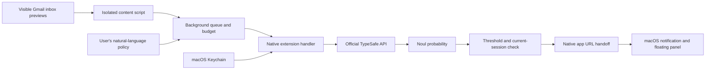

# Architecture and decision contract

## Data flow

## Gmail observation

No Gmail API, OAuth client, Google Cloud project, remote mailbox credentials or private Google endpoint. The content script observes `tr.zA` rows while the route is `#inbox`. It detects messages using `.bog` (subject/thread ID), `.yW [email]` (senders), `.y2` (preview), `.xW [title]` (received date). These are undocumented Gmail DOM selectors and must be maintained as Gmail changes. Unsupported markup/dates fail closed. The UI exposes a heartbeat and the count of unparsed timestamps.

A baseline excludes already rendered rows at activation/navigation/reload. Only subsequent changes with a sufficiently recent timestamp are eligible. Timestamps have minute precision; freshness permits the activation minute and rejects messages older than 15 minutes. New replies can reuse a thread ID; the deduplication signature includes the preview and timestamp. This is observation, not an authoritative mailbox change feed.

## Full-reading mode

Default: create an inactive about:blank tab, persist an ownership token, then navigate to the Gmail thread. Only the content script in this registered reader tab can retrieve its job. The reader extracts the last `.a3s` body, `.gD[email]` sender and `.g2[email]` recipients available in the message container. It clicks the exact English/Spanish Mark as unread control only when the source row was unread, then requires an unread row or explicit Gmail confirmation before returning. A successful restoration lets the background close its own tab; failures leave it open and are not automatically retried. There is no guarantee of restoration if Safari quits or crashes mid-read. Reading can briefly change the account unread count and other clients may observe this. Gmail dynamic iframe content is unsupported. Body is clipped to 12,000 characters before evaluation. The alternative preview-only mode never opens messages.

## Typed decision

`POST https://api.typesafe.ai/v1/systemone`, Bearer authentication. Pinned model `jev-1.13.0` by default; `jev-1.14.0` is opt-in. `state.email` contains bounded sender, subject, preview, received timestamp, unread flag, body and available recipients. `questions.notify` is a Noul. Its instructions carry the user's policy and an explicit untrusted-email boundary. Criteria distinguish satisfied policy from exclusion/no evidence. The only accepted answer is a finite numeric `answers.notify.noul` between 0 and 1 with the expected type. Native code rejects JSON booleans even though Foundation can bridge them to NSNumber.

The default threshold 0.8 is a provisional UX default, not a measured optimum. Test representative positive, negative, ambiguous, multilingual and injected examples before depending on the decisions. Jev does not produce explanations, generated notifications or arbitrary actions. Date arithmetic, budget accounting, deduplication and notification delivery stay in code.

## Lifecycle and failures

One serialized persistent queue handles every Gmail tab, bounded to 50 items. Deduplication keeps 2,000 SHA-256 fingerprints; status history keeps 40 records without email contents. A call is reserved against the UTC daily allowance after a successful optional read/restore and before starting TypeSafe I/O; failures may have consumed provider tokens, so reserved calls are not refunded. Up to two delayed retries use one-minute alarms and increasing waits; no replay beyond freshness/session limits. Manual synthetic connection tests are user-initiated and not governed by the automatic daily allowance.

Pausing/saving configuration bypasses the evaluation queue so it can invalidate an in-flight request immediately. An already sent request may still be billed, but its result will not generate a notice if the active session changed. WebExtension background suspension during native I/O can leave an in-progress item queued; recovery may repeat a provider call (at-least-once request semantics), not exactly-once billing. The system does not claim guaranteed delivery or an exact monetary spend cap.

Failures are visible status entries, not negative relevance answers. Authentication/request errors are not retried; transient failures are bounded. Once the automatic daily limit is reached, the filter pauses. Notifications are attempted after validation; a delivery error is displayed, and notification delivery itself is not retried automatically.

## Native boundary

Only extension UI pages can request key operations; only top-frame Gmail content scripts can enqueue previews. No externally-connectable or web-accessible resources. The native handler has a fixed API destination, ephemeral HTTPS session, disabled cookies/cache, 30-second request timeout and rejects redirects. It never logs messages, keys, provider response bodies or email fields. Keychain items are device-only and available while unlocked. One API key is shared across Safari profiles that use the same native extension installation.

The containing app requests notification authorization, schedules system notices and handles notification clicks. The native extension hands off bounded subject/sender/Gmail URL/style data with NSWorkspace to the exact containing app, using a local `gmailjev://notice` URL and no recent-items entry. The app queues launch-time requests until initialization finishes. The extension reports handoff acceptance rather than claiming visible delivery. App diagnostics distinguish panel visibility from system acceptance; neither bypasses Focus or macOS preferences.

The nonactivating panel joins Spaces, floats above normal windows, and remains until closed or replaced by a new match. The app remains running after the setup window closes so it can receive future notices; Quit exits it normally. Only one panel is retained. This delivery flow needs validation across target macOS versions.

The local URL scheme is not authenticated IPC: another local app or a website invoking the scheme can request a bounded notification with a Gmail destination. Such a card must not be treated as proof of sender identity or an authenticated Jev decision. The scheme cannot access keys, evaluate with TypeSafe, change criteria, read Gmail or open destinations outside Gmail.
